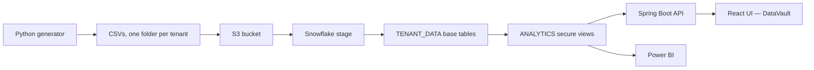

# DataVault — Snowflake Multi-Tenant Analytics Isolation Demonstrator

A SaaS analytics provider serving multiple customer companies from one shared Snowflake warehouse. The guarantee is simple: a tenant can only ever read its own data, and that is proven by direct SQL that bypasses the application — not by filters in the UI or in the BI layer.

Capstone project · Solo · Snowflake Standard Edition · Full stack: Snowflake SQL, Python, S3, IAM, Power BI, Spring Boot, React, GitHub Actions.

## What it proves

- Tenant A reads only Tenant A. Tenant B reads only Tenant B. A cross-tenant query returns 0 rows; a base-table read as an analyst is denied.
- Support access is time-limited, database-enforced, and logged — not an honour system.
- Usage is attributed per tenant by query tag, with metered credits and cost.

## Tenants

| Tenant | `tenant_id` | Customers | Orders | Order lines | Revenue |
| --- | --- | --- | --- | --- | --- |
| Steam Valve Corporation (A) | `STEAM` | 20 | 200 | 411 | 656,950.40 |
| Electronic Arts (B) | `EA` | 20 | 200 | 426 | 854,522.10 |

Tenant names are demo labels. All customers, products, and orders are synthetic data generated in Python (seed 30).

## Architecture



Python generates the CSVs, one folder per tenant in S3 (`cap30/STEAM/`, `cap30/EA/`). Snowflake loads them through a stage into the base tables. From there, everything is read only through secure views. Spring Boot passes the caller's role through to Snowflake and queries those views. React calls only the Spring Boot API. Power BI connects as the tenant role and reads the same views. Nothing else touches the base tables.

## How isolation works

Isolation is enforced in Snowflake, in two places, on every request:

1. **The API checks the session.** Sign-in is server-side (`POST /api/auth/login`); the server issues a token that maps to one Snowflake role, and every data request sends it as a `Bearer` token. Asking for the other tenant returns 403. There is no role header fallback.
2. **Snowflake checks the role.** Each secure view joins `ROLE_TENANT_MAP` on `CURRENT_ROLE()` and returns only rows whose tenant matches the role's tenant, or all rows where the mapped tenant is `ALL`. Analyst roles have no `SELECT` on the base tables and no `USAGE` on the `TENANT_DATA` schema, so a direct base-table read fails before it reaches any row.

| Role | Sees |
| --- | --- |
| `TENANT_A_ANALYST` | STEAM only |
| `TENANT_B_ANALYST` | EA only |
| `POWERBI_TENANT_A` | STEAM only |
| `POWERBI_TENANT_B` | EA only |
| `CAPSTONE_SUPPORT` | All tenants, only with an active grant, through secure views, logged |
| `CAPSTONE_ADMIN` | All, setup only |

**Support workflow.** Support requests access with a reason and a duration (1–480 minutes) through `TENANT_DATA.SP_SUPPORT_GRANT`. The procedure validates the request, writes a row to `SUPPORT_ACCESS_LOG`, and the views stay locked until a grant is active and unexpired. Customer names are masked for support. Access can be ended early with `SP_SUPPORT_REVOKE`. Support's own audit view (`ANALYTICS.V_SUPPORT_LOG`) shows only that user's grants.

Standard Edition has no row access policies or masking. Isolation here uses RBAC, secure views, and the role map instead.

## Data model

Database `CAPSTONE_DB`, warehouse `CAPSTONE_WH` (X-Small, single cluster, auto-suspend 60 seconds), resource monitor `CAPSTONE_RM` (10-credit cap). Base tables in `TENANT_DATA`, secure views in `ANALYTICS`. Every fact row carries `tenant_id`.

| Table | Rows | Purpose |
| --- | --- | --- |
| `TENANT` | 2 | Tenant master list |
| `CUSTOMER` | 40 | 20 per tenant |
| `PRODUCT` | 24 | 12 per tenant |
| `ORDERS` | 400 | 200 per tenant |
| `ORDER_LINE` | 837 | Revenue per line, STEAM 411 / EA 426 |
| `ROLE_TENANT_MAP` | 6 | Role-to-tenant mapping |
| `INGESTION_LOG` | 10 | One row per file loaded |
| `INGESTION_ERRORS` | 3 | Rejected rows, kept separate |
| `SUPPORT_ACCESS_LOG` | — | One row per support grant |

Revenue on `ORDER_LINE` is `quantity × unit_price × (1 − discount_pct / 100)`, verified against the source files on all 837 lines. Orphan checks (orders to customers, lines to orders, lines to products) all return 0.

## Verified results

| Check | Result |
| --- | --- |
| Tenant A on the KPI view | STEAM only — 200 orders, 20 customers, 656,950.40 |
| Tenant B on the KPI view | EA only — 200 orders, 20 customers, 854,522.10 |
| Cross-tenant read (`WHERE tenant_id = 'EA'` as A) | 0 rows |
| Base-table read as analyst | Denied — schema not authorized |
| Support without a grant | 0 rows on every view |
| Support with a 30-minute grant | STEAM 20 customers, names masked, log row written |
| Revoke, then query | 0 rows; re-grant restores 20 |
| Access-test runner (`tests/run_access_tests.py`) | 28/28, locally and in CI |
| Extended suite (`tests/test_isolation_extended.py`, T10–T19) | 10/10 |
| In-app evidence suite, re-run 14 Nov 2026 12:56 | 10/10, with Snowflake query IDs |
| Power BI, Tenant A report | STEAM only — 656,950.40, top customer Karan Sharma 71,355.70 |
| Power BI, Tenant B report | EA only — 854,522.10, top customer Ritu Khan 70,712.10 |
| Usage, last 7 days to 14 Nov 2026 | 4.69 credits, $11.24, 3,393 queries on `CAPSTONE_WH` |

Credit price: $2.40 per credit (AWS Asia Pacific, Thailand, Standard). Every API connection sets a query tag (`tenant`, `role`, `workload`), and every data response carries the Snowflake query ID in the `X-Snowflake-Query-Id` header.

## Running it

Prerequisites: a Snowflake account, Java 17, Maven, Node.js, Python 3 with `snowflake-connector-python`, and an S3 bucket with an IAM user that can read it.

```bash
# 1. Snowflake — setup, load, hardening, in order
#    sql/sql-03-setup.sql, sql/sql-03-load.sql, then sql/01_users_and_roles.sql
#    through sql/06_support_revoke.sql (see docs/05_runbook.md for the order)

# 2. Backend — Spring Boot does not read .env, so export the credentials first
set -a; source .env; set +a
cd app && mvn spring-boot:run        # http://localhost:8080

# 3. Frontend
cd frontend && npm install && npm run dev   # http://localhost:5173

# 4. Tests (use `python`, not `python3`, on macOS)
cd tests && python run_access_tests.py
SLOW_TESTS=1 python -m pytest test_isolation_extended.py
```

Demo accounts for evaluation: `steam_analyst` (Tenant A), `ea_analyst` (Tenant B), `support_user` (Platform Support). Authentication is application-managed for evaluation — the provisioned credentials are held in `AuthService.java`; a production deployment would use a proper identity provider. The sign-in screen takes a username and password; a wrong login returns 401.

Power BI connects DirectQuery to `CAPSTONE_DB.ANALYTICS` as the tenant user (`POWERBI_A_USER` / `POWERBI_B_USER`). There is no Power BI row-level security — isolation comes from the secure views. Note that Power BI Desktop stores one login per Snowflake server: switch credentials in Data source settings before opening the other tenant's report, and never save a report while it is showing the other tenant's data.

## Repository layout

```
/sql          Snowflake setup, load, hardening (01–06), proof, reconciliation
/python       Synthetic data generator and validation
/data         Generated CSVs, one folder per tenant (STEAM/, EA/)
/app          Spring Boot API (Java 17)
/frontend     React UI — DataVault (calls the API only)
/powerbi      Connection notes (reports themselves are not committed)
/docs         Scope, architecture, task guides, runbook, demo script,
              screenshots, Final-Documentation.pdf
/demo         Demo script
/infra        Terraform for the S3 bucket and IAM user
/tests        Access-test runner (28 checks) and extended suite (T10–T19)
AI_USAGE_LOG.md
README.md
```

## Documentation

- Full write-up: `docs/Final-Documentation.pdf` (57 pages) — design, build, evidence, limitations, and the AI usage log.
- Task guides: `docs/task-01-scope.md` through `docs/task-09-guide.md`, plus `docs/05_runbook.md` and `docs/demo-script.md`.
- AI usage: `AI_USAGE_LOG.md` records how AI assistance was used, one row per task, in the author's own words.

## Tests and CI

`.github/workflows/test.yml` runs four jobs on push, pull request, and manual trigger: `lint-sql`, `access-tests` (the 28-check runner against live Snowflake), `build-api`, and `build-frontend`.

## Limitations

- The S3 storage integration is blocked by organisation policies (RCP denies `sts:AssumeRole` for principals outside the organisation; SCP restricts it by region). The load uses an IAM user with access keys in the stage instead. The integration design stays in the repo as the intended approach.
- Standard Edition has no row access policies, masking, or multi-cluster warehouses. The design works within those limits.
- `ACCOUNT_USAGE` views lag real time by 45 minutes to 3 hours, so usage figures are always slightly behind.
- Power BI Desktop keeps one Snowflake login per server, so the two tenant reports cannot be open in parallel in Desktop. Parallel viewing needs the Power BI service, where each dataset keeps its own login.
- Report files (`.pbix`) are not committed. Evidence for the reports is the screenshots in `docs/screenshots/` and the verified figures above.

## Tasks

| Task | Status |
| --- | --- |
| 1. Problem model and success measures | Done |
| 2. Architecture and data model | Done |
| 3. Environment, synthetic data, ingestion | Done |
| 4. Isolation control | Done |
| 5. Roles and support workflow | Done |
| 6. Access tests | Done |
| 7. Usage monitoring | Done |
| 8. Power BI layer + application layer | Done |
| 9. Repeatability and CI | Done |
| 10. Documentation and defense | Done — documentation; viva defense to follow |
