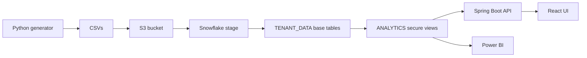
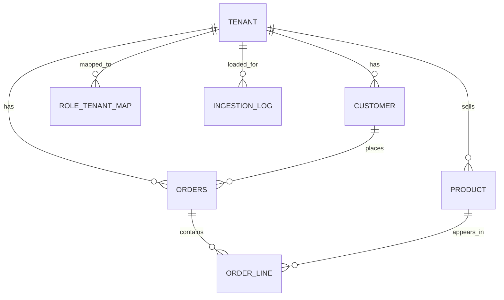
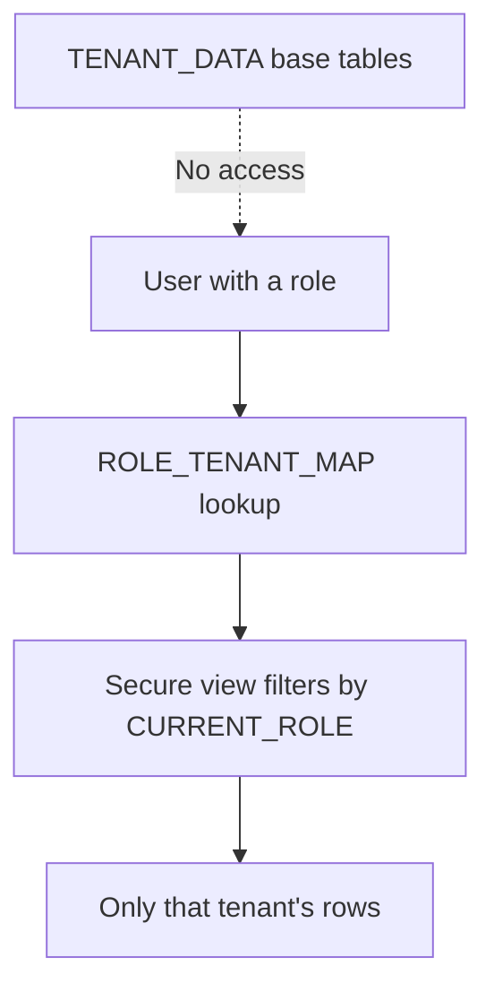

# CAP-30 — Snowflake Multi-Tenant Analytics Isolation Demonstrator

A SaaS analytics provider serving multiple customers from one shared warehouse. Each tenant must only ever see its own data, proven by direct SQL that bypasses the app — not by hiding things in the UI.

Solo project. Snowflake Standard Edition. Full stack: Snowflake SQL, Python, S3, IAM, Power BI, Spring Boot, React, GitHub Actions.

## Tenants

| Tenant | tenant_id | Customers | Orders | Revenue |
| --- | --- | --- | --- | --- |
| Steam Valve Corporation (A) | STEAM | 20 | 200 | 656,950.40 |
| Electronic Arts (B) | EA | 20 | 200 | 854,522.10 |

Names are demo labels. All customers, products, and orders are synthetic.

## Architecture



Python makes the CSVs. They go to S3. Snowflake reads them through a stage into the base tables. Everything is then read only through secure views. Spring Boot passes the caller's role through and queries those views. React only calls Spring Boot. Power BI connects as the tenant role and reads the same views. Nothing else touches the base tables.

## Data model



Database `CAPSTONE_DB`. Base tables in `TENANT_DATA`, secure views in `ANALYTICS`. Every fact row carries `tenant_id`.

| Table | Rows | Purpose |
| --- | --- | --- |
| TENANT | 2 | Tenant master list |
| CUSTOMER | 40 | One tenant per customer, 20 each |
| PRODUCT | 24 | One tenant per product, 12 each |
| ORDERS | 400 | One tenant per order, 200 each |
| ORDER_LINE | 837 | Revenue per line, STEAM 411 / EA 426 |
| ROLE_TENANT_MAP | 6 | Role to tenant mapping |
| INGESTION_LOG | 6 | One row per file loaded |
| INGESTION_ERRORS | 3 | Bad rows kept separate |
| SUPPORT_ACCESS_LOG | 1 | One row per support access |

## How isolation works



Analyst roles get no SELECT on the base tables and no USAGE on the `TENANT_DATA` schema. They only get SELECT on the secure views in `ANALYTICS`. Each view joins `ROLE_TENANT_MAP` on `CURRENT_ROLE()` and returns only rows where the mapped tenant matches the row's tenant, or where the mapped tenant is `ALL`.

| Role | Sees |
| --- | --- |
| TENANT_A_ANALYST | STEAM only |
| TENANT_B_ANALYST | EA only |
| POWERBI_TENANT_A | STEAM only |
| POWERBI_TENANT_B | EA only |
| CAPSTONE_SUPPORT | All, via secure views, logged |
| CAPSTONE_ADMIN | All, setup only |

## Verified results

| Test | Result |
| --- | --- |
| Tenant A sees only STEAM | V_KPIS STEAM 656,950.40, 200 orders, 20 customers |
| Tenant B sees only EA | V_KPIS EA 854,522.10, 200 orders, 20 customers |
| B accessing A | 0 STEAM rows, 20 EA customers |
| Base-table read as analyst | Denied, schema not authorized |
| Support workflow | V_KPIS both tenants, SUPPORT_ACCESS_LOG 1 row |
| Revoke and re-grant | Denied after revoke, 20 again after re-grant |
| Warehouse usage | CAPSTONE_WH about 0.31 credits total |
| Query tags | STEAM and EA tags visible in query history |

## Repo layout

```
/sql        — Snowflake setup, tables, views, grants, tests
/python     — synthetic data generator, validation, ingestion
/app        — Spring Boot app
/frontend   — React UI, calls the Spring Boot API only
/powerbi    — report notes and connection details
/docs       — scope, architecture, guides, runbook, demo script
/tests      — negative access tests and expected results
AI_USAGE_LOG.md
README.md
```

## Tasks

| Task | Status |
| --- | --- |
| 1. Problem model and success measures | Done |
| 2. Architecture and data model | Done |
| 3. Environment, synthetic data, ingestion | Done |
| 4. Isolation control | Done |
| 5. Roles and support workflow | Done |
| 6. Access tests | Done |
| 7. Usage monitoring | Done |
| 8. Power BI layer + React UI | Done |
| 9. Repeatability | Done |
| 10. Documentation and defense | Pending |

## Docs

- Scope: `docs/task-01-scope.md`
- Architecture: `docs/task-02-architecture.md`
- Task guides: `docs/task-03-guide.md` through `docs/task-08-guide.md`
- AI usage log: `AI_USAGE_LOG.md`, kept from Task 1 onwards

## Limitations

- Standard Edition has no row access policies. Isolation uses RBAC, secure views, and the role map instead.
- The S3 storage integration is blocked by org policies (RCP denies `sts:AssumeRole` for principals outside the org, SCP restricts it by region). The load uses an IAM user with access keys in the stage instead. The integration design stays in the repo.
- Support access is procedural: the log row must be inserted before the query. Nothing in Snowflake enforces that order.
- `ACCOUNT_USAGE` views lag real time by 45 minutes to 3 hours.
