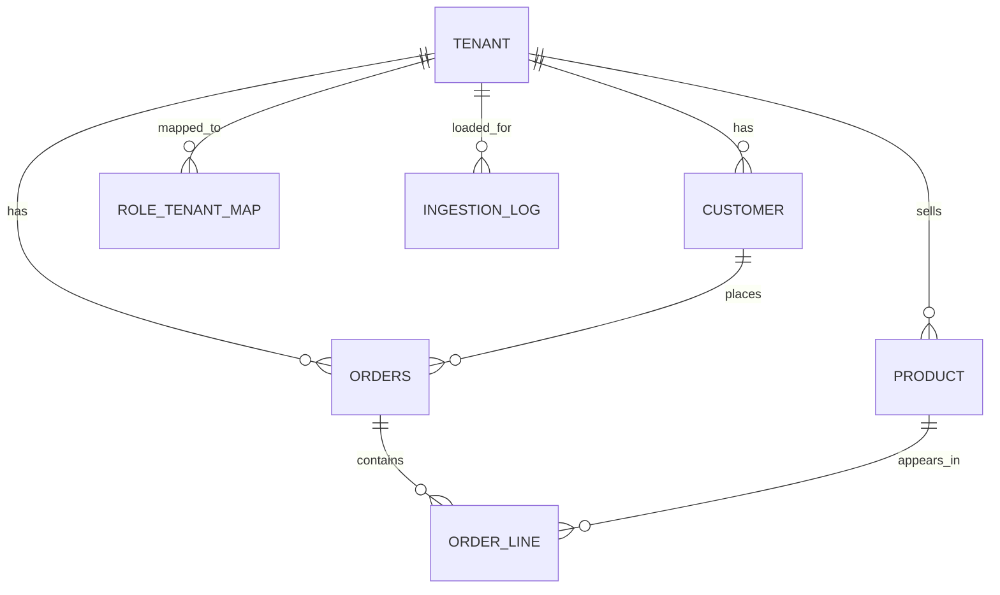
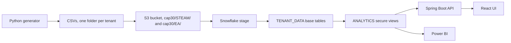

# CAP-30 — Task 2: Architecture and data model

## How the pieces fit together

Data is made in Python, put in S3, loaded into Snowflake, and then only ever read through secure views. The app and Power BI sit on top of those views. They do not get to touch the base tables.

So if someone skips the app and goes straight to Snowflake with SQL, they still only see their own tenant. That is the whole point.

## The tenants, and the tenant id

There are two tenants.

Tenant A is Steam Valve Corporation. Its tenant\_id is `STEAM`.
Tenant B is Electronic Arts. Its tenant\_id is `EA`.

Short ids like that were picked on purpose. In a test result, `STEAM` and `EA` are easy to tell apart, and a leak is obvious straight away. If the ids were just 1 and 2, a mistake would be harder to spot.

Every fact row carries a tenant\_id. No exceptions. If a row comes in without a proper one, it does not go into the main tables — it goes to the error table in Task 3.

## The tables

Database is `CAPSTONE_DB`. Base tables live in `TENANT_DATA`. Secure views live in `ANALYTICS`, in Task 4. Keeping them in different schemas makes the grants easier to explain: analysts get nothing in `TENANT_DATA`, and only SELECT on the views in `ANALYTICS`.

### TENANT

One row per tenant. This is the master list.

- tenant\_id VARCHAR(10), primary key — `STEAM` or `EA`
- tenant\_name VARCHAR — Steam Valve Corporation / Electronic Arts
- created\_at TIMESTAMP

Only 2 rows, ever.

### CUSTOMER

A customer belongs to one tenant. The same customer id in the other tenant is a different person — that is why the key is tenant plus customer.

- tenant\_id VARCHAR(10), part of the primary key, references TENANT
- customer\_id VARCHAR, part of the primary key — like `STEAM_C001`
- customer\_name VARCHAR — made-up names only
- city VARCHAR
- region VARCHAR — North / South / East / West, just for slicing in Power BI
- segment VARCHAR — Consumer / Small Business / Corporate, same idea
- created\_at TIMESTAMP

About 20 per tenant.

### PRODUCT

A game sold by that tenant. Again, a product belongs to one tenant only.

- tenant\_id VARCHAR(10), part of the primary key, references TENANT
- product\_id VARCHAR, part of the primary key — like `STEAM_P001`
- product\_name VARCHAR — made-up game titles only, no real Steam or EA titles
- category VARCHAR — Action, Sports, RPG, Strategy, and so on
- list\_price NUMBER(10,2)

About 10 to 15 per tenant. Categories are kept simple so the Power BI charts have something to group by.

### ORDERS

One row per order.

- tenant\_id VARCHAR(10), part of the primary key, references TENANT
- order\_id VARCHAR, part of the primary key — like `STEAM_O001`
- customer\_id VARCHAR, references CUSTOMER for the same tenant
- order\_date DATE
- sales\_channel VARCHAR — Online / Retail Store / Partner

About 200 per tenant.

### ORDER\_LINE

One row per game in an order. This is where the money is.

- order\_line\_id VARCHAR, primary key — like `STEAM_L0001`
- tenant\_id VARCHAR(10), references TENANT
- order\_id VARCHAR, references ORDERS for the same tenant
- product\_id VARCHAR, references PRODUCT for the same tenant
- quantity INT
- unit\_price NUMBER(10,2)
- discount\_pct NUMBER(5,2) — 0, 5, 10, or 15
- revenue NUMBER(12,2) — quantity \* unit\_price \* (1 - discount\_pct / 100)

Most orders have 1 to 3 lines. Revenue is stored at load time, not calculated in every report, so the KPIs are just sums.

## ERD

In plain words: a tenant has customers, products, and orders. A customer places orders. An order has order lines. Each order line points to one product. The role map and the ingestion log both point back to the tenant as well.

## The other two tables

These are not business data, they are for control and for proving what happened.

### ROLE\_TENANT\_MAP

This is the table the secure views join to. It says which role is allowed to see which tenant.

- role\_name VARCHAR, primary key
- tenant\_id VARCHAR, references TENANT — or `ALL` for support, see below
- note VARCHAR

Rows planned for now:

- TENANT\_A\_ANALYST → STEAM
- TENANT\_B\_ANALYST → EA
- POWERBI\_TENANT\_A → STEAM
- POWERBI\_TENANT\_B → EA
- CAPSTONE\_SUPPORT → ALL, only through the support view, and logged
- CAPSTONE\_ADMIN → ALL, admin only, not used for analyst queries

Support and admin are the only `ALL` rows. That is on purpose, and it is written down here so it can be questioned in defense.

### INGESTION\_LOG

One row per file loaded, so the numbers can be checked later.

- log\_id INT, auto-increment, primary key
- file\_name VARCHAR
- table\_name VARCHAR
- tenant\_id VARCHAR
- rows\_loaded INT
- rows\_rejected INT
- loaded\_at TIMESTAMP
- status VARCHAR — LOADED / PARTIAL / FAILED

### SUPPORT\_ACCESS\_LOG

One row every time support looks at data.

- log\_id INT, auto-increment, primary key
- accessed\_by VARCHAR — the role that was used
- tenant\_id VARCHAR — which tenant was looked at, or ALL
- reason VARCHAR — why support needed it
- accessed\_at TIMESTAMP

## Role mapping, in short

| Role | Sees |
| --- | --- |
| TENANT\_A\_ANALYST | STEAM only |
| TENANT\_B\_ANALYST | EA only |
| POWERBI\_TENANT\_A | STEAM only |
| POWERBI\_TENANT\_B | EA only |
| CAPSTONE\_SUPPORT | All, but only via the support view, and logged |
| CAPSTONE\_ADMIN | All, for setup only |

No analyst role gets SELECT on `TENANT_DATA` at all. That grant is never given. They only get SELECT on the views in `ANALYTICS`.

## Data flow

Step by step:

Python makes the CSVs — tenants, customers, products, orders, order lines — one folder per tenant (`data/STEAM/`, `data/EA/`), so no file ever mixes the two companies. Those go to S3 under `cap30/STEAM/` and `cap30/EA/`, with `tenants.csv` and `edge_cases.csv` at the top level. Snowflake reads them from S3 through a stage (IAM-user credentials — the storage integration is blocked by org policy, see Task 3), then COPY INTO the base tables, one COPY per tenant per table. Counts are checked against INGESTION\_LOG. Then the secure views in ANALYTICS filter by role. Spring Boot connects as the tenant role and queries those views. React only calls Spring Boot. Power BI connects as the tenant Power BI role and reads the same views.

Nothing else reads the base tables. Not React, not Power BI, not the analysts.

## The API, in brief

Spring Boot does not filter rows in Java code. It just passes the caller's role through to Snowflake and lets the view do the filtering. That matters — if the filtering was in Java, someone could bypass it with SQL.

Planned endpoints, all read-only:

- GET /api/kpis?tenant=STEAM — total revenue, total orders, total customers, average order value for that tenant
- GET /api/orders?tenant=STEAM — orders for that tenant
- GET /api/orders/{orderId}?tenant=STEAM — one order, with its lines

If the tenant in the URL does not match the role, the view returns no rows. That is the test in Task 6.

## Warehouse and environment

One warehouse: `CAPSTONE_WH`, X-Small, single cluster, auto-suspend 60 seconds, auto-resume on. Standard Edition has no multi-cluster, so workloads are told apart with query tags and by role in the usage reports, not by having a warehouse per workload.

Database: `CAPSTONE_DB`, schemas `TENANT_DATA` and `ANALYTICS`.

## Decisions that might get questioned

Why not row access policies? Because Standard Edition does not have them. They need Enterprise. So this uses RBAC plus secure views plus the role map instead. It is a limit of the edition, and it is written here rather than hidden.

Why is tenant\_id on every table, not just orders? So a join cannot accidentally drop the tenant filter. If every table has it, the view can filter at any step.

Why store revenue on ORDER\_LINE instead of calculating it every time? So the KPIs are simple sums, and the same number shows up in Snowflake, in the API, and in Power BI. If each layer calculated it differently, the reconciliation in Task 10 would never match.

Why STEAM and EA as ids, not TENANT\_A and TENANT\_B? Because they are clearer in test output, and a leaked row is obvious. The full names are still in the TENANT table.

Why one folder per tenant in S3, not one CSV per table? Because a single file holding both tenants' rows would put both companies' data in one object — anyone with read on that file sees both. Per-tenant folders keep the separation from the landing zone onward, so a leaked or mis-shared file exposes one tenant, not both. The stage user still reads both folders to load them, so the security boundary stays Snowflake — the folders are correct data engineering, not a replacement for the views.

## 